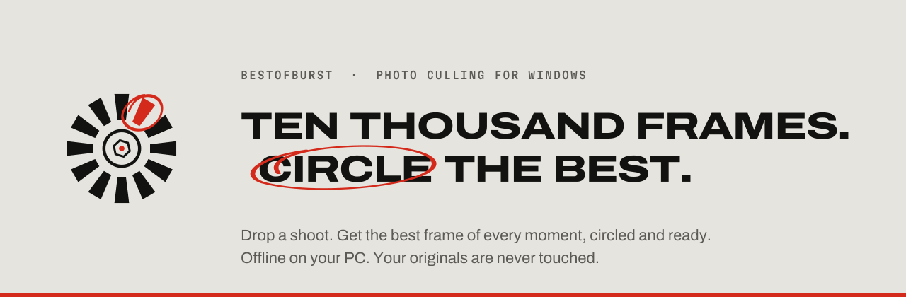
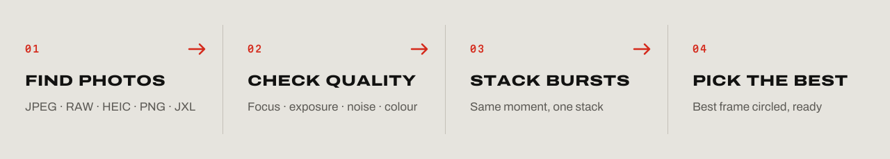
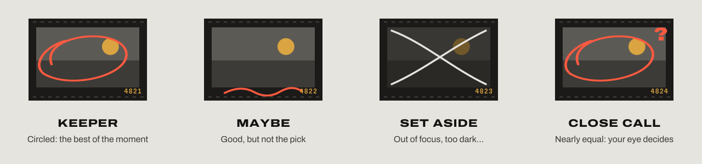
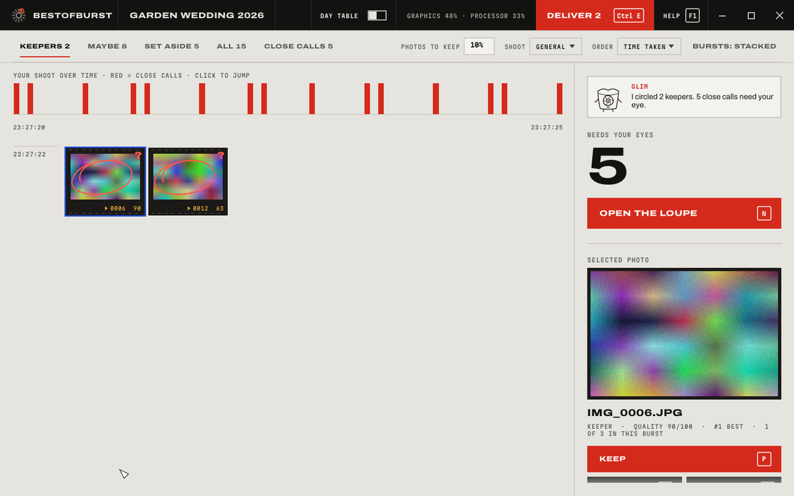
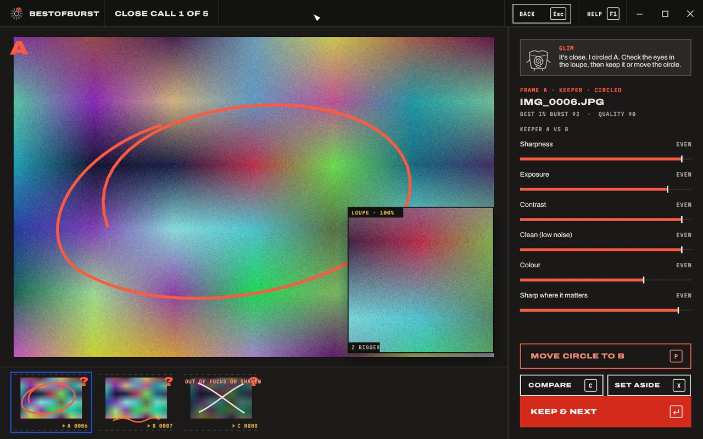
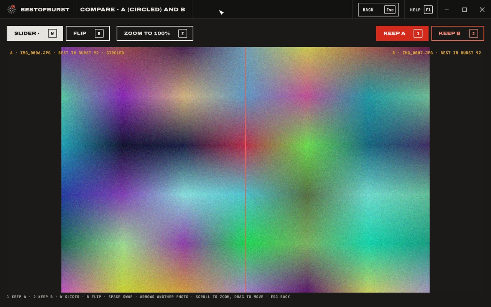
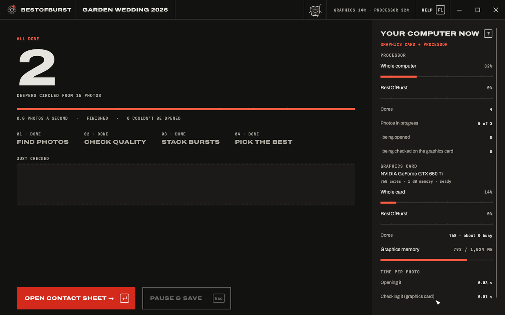
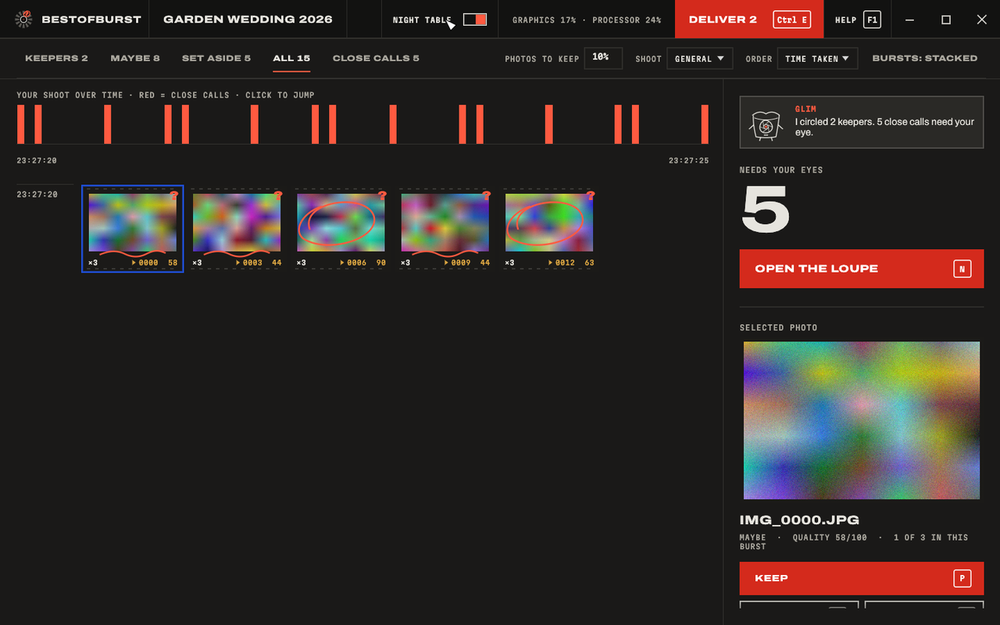
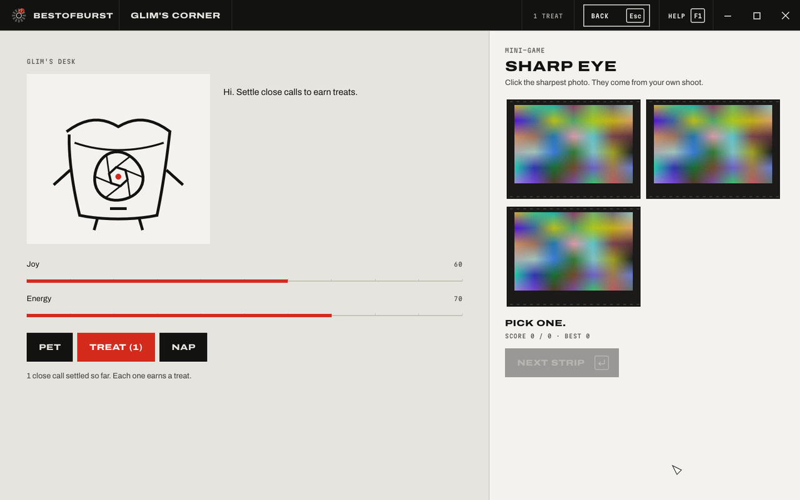

<p align="center">
  <picture>
    <source media="(prefers-color-scheme: dark)" srcset="docs/readme/hero-dark.svg">
    
  </picture>
</p>

<p align="center">
  <a href="https://github.com/IHANsaja/BestOfBurst/releases/latest"></a>
  <a href="https://github.com/IHANsaja/BestOfBurst/releases"></a>
  
  
  
  
  
  <a href="LICENSE"></a>
</p>

<p align="center"><b>BestOfBurst culls a shoot for you.</b> Drop in a folder of thousands of photos and it stacks every burst, sets aside the out-of-focus and badly exposed frames, and circles the best photo of each moment. You only look where it's a genuine close call.</p>

---

## Download

Get the latest version from the **[Releases page](https://github.com/IHANsaja/BestOfBurst/releases/latest)**.

| File | Choose this if |
| --- | --- |
| `BestOfBurst-<version>-Setup-64bit.exe` | **Most people.** Installs BestOfBurst with a Start Menu shortcut. For 64-bit Windows. |
| `BestOfBurst-<version>-Setup-32bit.exe` | Your PC runs 32-bit Windows (older machines). Also works on 64-bit. |
| `BestOfBurst-<version>-Portable-64bit.exe` | You'd rather not install anything: one file, double-click to run. |
| `BestOfBurst-<version>-Portable-32bit.exe` | Portable, for 32-bit Windows. |

> **Not sure which?** Open *Settings › System › About* and look at *System type*. "64-bit operating system" means the 64-bit files. Almost every PC from the last decade is 64-bit.
>
> The files aren't code-signed yet, so Windows SmartScreen may ask you to confirm the first time (*More info › Run anyway*).

## How it works

<p align="center">
  <picture>
    <source media="(prefers-color-scheme: dark)" srcset="docs/readme/pipeline-dark.svg">
    
  </picture>
</p>

1. **Choose a shoot**: drop a folder on the window. Set how many photos you want to keep (a number like `300`, or a share like `10%`) and the type of shoot.
2. **Start culling**: every photo is checked for focus, exposure, contrast, noise and colour. Photos of the same moment are stacked together.
3. **Look at the close calls**: open the loupe to see the subject at 100 % and decide in a keystroke.
4. **Deliver**: your keepers land in a `picks` folder inside the shoot, numbered best-first, ready for Lightroom, Capture One or your client.

Your original files are **never** changed, moved, renamed or deleted, and nothing ever leaves your computer.

## The marks

Every decision is a hand-drawn mark, readable at a glance, like grease pencil on a light table.

<p align="center"></p>

## Screens

<table>
  <tr>
    <td width="50%"><br><sub><b>Contact sheet</b>: your shoot over time, bursts stacked, keepers circled.</sub></td>
    <td width="50%"><br><sub><b>Loupe</b>: one moment at a time, with the subject at 100 %.</sub></td>
  </tr>
  <tr>
    <td><br><sub><b>Compare</b>: slide or flip between the circled frame and the runner-up.</sub></td>
    <td><br><sub><b>Culling</b>: live progress, plus what your processor and graphics card are doing.</sub></td>
  </tr>
  <tr>
    <td><br><sub><b>Night table</b>: one switch for dim rooms.</sub></td>
    <td><br><sub><b>Glim</b>: a small helper who earns treats for every close call you settle.</sub></td>
  </tr>
</table>

<sub>Screens shown with synthetic test photos.</sub>

## Features

- **Burst stacking**: photos of the same moment are grouped, even when you return to the same pose a minute later. By default only the best frame of each moment becomes a keeper.
- **Sharp where it matters**: within a burst, frames are compared on the subject, so a busy background never beats a sharp face.
- **Honest set-asides**: out of focus or shaken, blown highlights, too dark, flat. Every reason is shown, and you can overrule any decision.
- **Close calls only**: frames that are nearly equal get a **?**. Press **N** to walk through them, **Z** for 100 %, **Enter** to keep.
- **Fast**: uses your graphics card when it helps (DirectX 12 or Vulkan) and every processor core you allow, and shows you exactly what it's doing.
- **Resumable**: pause at any time; progress is saved and picked up where you left off. Changing how many to keep re-ranks in under a second.
- **RAW, HEIC and more**: JPEG, PNG, TIFF, WebP, JPEG XL, HEIC/HEIF, AVIF and RAW from Canon, Nikon, Sony, Fujifilm, Olympus, Panasonic, Pentax, Leica, DNG and others.
- **Plain-language help** on every option, keyboard shortcuts for everything, light and dark tables, and a short break reminder after 20 minutes of reviewing.

## Speed

Opening each photo file always happens on the processor. The graphics card then takes over the rest of the work: resizing, checking quality, burst matching and the thumbnail. Results match the processor-only path.

Measured on an Intel Core i5-3330 (4 cores) with an NVIDIA GeForce GTX 650 Ti, culling 40 photos of 24 megapixels:

| Speed setting | Photos at once | Photos per second |
| --- | :---: | :---: |
| Processor only | 3 (default) | 4.6 |
| Graphics card | 3 (default) | **5.7** |
| Processor only | 4 | 6.5 |
| Graphics card | 4 | **7.0** |

Home shows how many photos at once your computer allows (for example **3 / 4**) and explains the choice.

## Supported formats

| Format | How it's opened |
| --- | --- |
| JPEG, PNG, TIFF (8/16-bit), WebP, BMP, GIF, TGA, QOI, PNM, JPEG XL | Built in |
| RAW: CR2, CR3, CRW, NEF, NRW, ARW, SR2, DNG, RAF, ORF, RW2, PEF, IIQ, 3FR, X3F and more | The full-size preview inside the RAW file |
| HEIC / HEIF (iPhone) | Windows, with the free *HEIF Image Extensions* and *HEVC Video Extensions* |
| AVIF | Windows, with the free *AV1 Video Extension* |
| RAW without a usable preview | Windows, with the free *Raw Image Extension* |

If an add-on is missing, BestOfBurst tells you which one to get from the Microsoft Store. Afterwards, tick *Try again on photos that couldn't be opened*.

## Keyboard

| Where | Key | Action |
| --- | --- | --- |
| Everywhere | F1 | Help |
| | Ctrl+Z / Ctrl+Y | Undo / redo (50 steps) |
| | Esc | Back |
| Contact sheet | Arrows | Move |
| | P / U / X / 0 | Keeper / maybe / set aside / reset |
| | Space | Open the loupe on this burst |
| | N | Next close call |
| | C | Compare |
| | G | Spread out or stack this burst |
| | 1 / 2 / 3 / 4 | Keepers / Maybe / Set aside / All |
| | Ctrl+E | Deliver |
| Loupe | Left / Right, 1–4 | Another photo of the burst |
| | P | Move the circle |
| | Enter | Keep & next close call |
| | Z | Bigger loupe |
| Compare | 1 / 2 | Keep A / keep B |
| | W / B / Space | Slider / flip / swap |
| | Z | Zoom to 100 % |

## Delivery

**Deliver** (Ctrl+E) writes into `<your shoot>\_bestofburst\`:

| Folder or file | Contents |
| --- | --- |
| `picks\` | Your keepers, numbered best-first: `0001_IMG_4821.CR3`, `0002_...` |
| `maybe\` | *(optional)* good photos that didn't make the cut |
| `rejects\<reason>\` | *(optional)* set-aside photos, one folder per reason |
| `report.csv` | Every photo with its quality and decision; opens in Excel |

Files in these folders are shortcuts (hard links) by default: they open like the real photos but take no extra disk space, and deleting one never deletes your original. **If you plan to edit photos inside `picks`, tick *Make full copies***, because saving over a shortcut changes the original too.

---

## For developers

<details>
<summary><b>Build from source</b></summary>

Requirements: Windows 10/11, [Rust](https://rustup.rs) stable (MSVC), Visual Studio Build Tools with *Desktop development with C++*, and [Inno Setup 6](https://jrsoftware.org/isinfo.php) for the installers.

```bash
cargo build --release
```

Every release file (64-bit and 32-bit installers and portable exes):

```bash
rustup target add i686-pc-windows-msvc
```

```bash
powershell -ExecutionPolicy Bypass -File installer\build.ps1
```

Output lands in `installer\Output\`.

</details>

<details>
<summary><b>Command line</b></summary>

The same exe has a command line for scripting and batch use:

```text
bestofburst run <FOLDER> [--keep <N> | --keep-percent <P>] [--preset <general|portrait|sports|landscape>]
                  [--out <DIR>] [--threads <N>] [--max-per-group <N>]
                  [--maybe] [--rejects] [--copy] [--keep-names] [--retry-failed]
                  [--engine <auto|gpu|cpu>]
bestofburst rank <FOLDER> [same ranking and output flags as run]   # re-rank from state.json only
bestofburst status <FOLDER> [--out <DIR>]
bestofburst ui [FOLDER]
bestofburst probe <FILE>                                            # format, metrics, GPU vs CPU timing
```

</details>

<details>
<summary><b>Architecture</b></summary>

| Path | Role |
| --- | --- |
| `src/scan.rs` | Folder walk, skip rules, format detection by file signature |
| `src/decode/` | Decoders: zune-jpeg, image, jxl-oxide, embedded RAW preview, Windows Imaging Component |
| `src/analyze.rs` | Eight metrics over an 8 × 8 tile grid, 64-bit dHash, capture time |
| `src/gpu.rs` | wgpu compute shaders: Catmull-Rom resize, tile sums, dHash cells, thumbnail |
| `src/rank.rs` | Burst grouping with look-back, rejects, percentile scoring, subject sharpness, selection |
| `src/state.rs` | `state.json`: resumable progress, rankings and your choices (atomic saves) |
| `src/output.rs` | Picks / maybe / rejects folders (hard links or copies), `report.csv` |
| `src/engine.rs` | The pipeline shared by the window and the CLI |
| `src/sysmon.rs` | Live CPU and GPU readings (Windows counters, NVML) |
| `src/ui/` | The egui window in the Grease Pencil design system ([DESIGN.md](DESIGN.md)) |

Grouping constants and set-aside thresholds live at the top of `src/rank.rs`. Tune them against a real shoot.

</details>

<details>
<summary><b>Tests</b></summary>

```bash
cargo test
```

24 tests cover the metrics, GPU-vs-CPU agreement, the RAW preview path, every pure-Rust format, ranking, state saving and resume, output safety (originals hashed before and after) and the whole window, driven offscreen with egui_kittest. Set `BOB_UI_SNAPSHOTS=<dir>` to save a render of each screen.

The README artwork in `docs/readme/` is generated by `python docs/readme/make_svgs.py`.

</details>

<details>
<summary><b>Notes against the original build spec</b></summary>

- The package has a library target next to the binary so `tests/` can reach the engine; the build still produces one `bestofburst.exe`.
- The shared run loop lives in `src/engine.rs` instead of `main.rs`, so the window and the CLI call one implementation.
- The `image` crate also enables `jpeg`, to encode the 320 px thumbnails.
- Rejected files get percentiles interpolated against the eligible set, so their report scores stay comparable.
- GPU analysis (out of scope in the prototype spec) is optional and falls back to the CPU per photo.

</details>

## Design

The interface follows **Grease Pencil**, BestOfBurst's design system: a light table by day and a darkroom by night, with photos as the only colourful things on screen. See **[DESIGN.md](DESIGN.md)** for the tokens, type, marks, components and screens.

The logo is a burst of twelve frames around an aperture, with one frame lit and circled: the best of the burst. Source files are in `assets/logo/` (SVG, PNG 16–512 px and ICO).

## License

Proprietary software. Copyright © 2026 Ihan Hansaja. All rights reserved. Use is governed by the [End User License Agreement](LICENSE); a license key is required beyond any trial period.

Bundles **Archivo** and **Martian Mono** under the SIL Open Font License 1.1 (`assets/fonts/OFL-*.txt`), instanced from [google/fonts](https://github.com/google/fonts). Built with [egui](https://github.com/emilk/egui), [wgpu](https://github.com/gfx-rs/wgpu), [image](https://github.com/image-rs/image), [zune-jpeg](https://github.com/etemesi254/zune-image), [jxl-oxide](https://github.com/tirr-c/jxl-oxide) and [rayon](https://github.com/rayon-rs/rayon).
