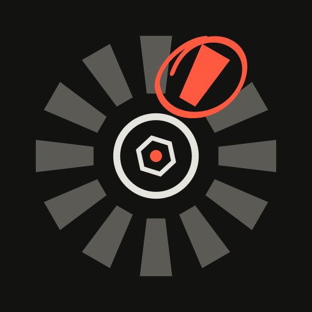

<p align="center"></p>

# BestOfBurst (prototype)

One Windows exe, written in Rust, that turns a folder of photos (10,000+ is fine) into a `picks`
folder of the best N shots. It runs offline on the CPU, uses no AI/ML and no database, and keeps
all progress in one `state.json`, so an interrupted run resumes where it stopped.

## Build

Prerequisites: Rust stable with the MSVC toolchain and Visual Studio Build Tools with
"Desktop development with C++".

```bash
cargo build --release
```

The result is `target\release\bestofburst.exe`.

To build the Windows installer, install [Inno Setup 6](https://jrsoftware.org/isinfo.php) and run:

```bash
ISCC.exe installer\bestofburst.iss
```

It writes `installer\Output\BestOfBurst-Setup-<version>.exe`. The installer works per user
without admin rights (or for all users) and adds a Start Menu shortcut and an uninstaller.

## Use

Double-click `bestofburst.exe` (or run `bestofburst ui [FOLDER]`) to open the window. The window
follows the **Grease Pencil** design system in [DESIGN.md](DESIGN.md): a light table (or a night
table) where every decision is a hand-drawn mark. A **circle** means keeper, a **wave** means
maybe, a **cross** means set aside, and **?** marks a close call.

1. **Home**: drop a shoot folder (or click the drop zone), set **Keep** (a number, or a
   percentage like `10%`) and the **shot type**, then press **Develop**.
2. **Processing**: frame counter, steps, live film strip. **Pause & save** stops and resumes
   later; **Open contact sheet** continues when it's done.
3. **Contact sheet**: a timeline of the shoot (red bars hold close calls) and time rows of six
   marked frames. The side panel shows how many close calls need your eyes.
4. **Loupe** (focus): one same-shot group on the night table with the subject at 100 %.
   Keep the circle or move it, then go to the next close call.
5. **Compare**: wipe or blink between the keeper (A) and the runner-up (B).
6. **Done**: the keeper count circled, delivery options, and **Deliver**.
7. **Glim's corner**: Glim, the pencil mascot. Every close call you settle earns a treat;
   spend them here, or play **Sharp Eye** with frames from your own shoot.

After 20 minutes of review a dismissable **safelight break** suggests resting your eyes.
Every option has a **?** button with a plain-language explanation, and **Help (F1)** explains the
whole app. The window draws its own title bar in the same style: drag it to move, double-click to
maximize, and resize from any edge.

### GPU and CPU

Home's **Engine** setting picks the hardware: **Auto** (the graphics card when one works, else the
processor), **GPU** or **CPU**. Opening (decoding) each photo always runs on the CPU. With the GPU,
the graphics card then does the resize to 2,048 px, the measurements, the dHash and the thumbnail
through wgpu compute shaders (DirectX 12 or Vulkan). Any GPU problem falls back to the CPU for
that photo, and the results match the CPU path to about four significant digits.

The Processing screen shows the engine live: processor use (whole computer and BestOfBurst),
cores and busy workers, graphics-card use, cores (NVIDIA reports them; other drivers do not),
video memory, and the average time per photo for each step.

Measured on an Intel i5-3330 (4 cores) with a GeForce GTX 650 Ti, 40 photos of 24 MP:

| Engine | Threads | Photos per second |
| --- | --- | --- |
| CPU | 3 (default) | 4.6 |
| GPU | 3 (default) | 5.7 |
| CPU | 4 | 6.5 |
| GPU | 4 | 7.0 |
The day/night table choice and Glim's state are saved in `%APPDATA%\bestofburst\settings.json`.

| Where | Key | Action |
| --- | --- | --- |
| Contact sheet | Arrows | Move selection |
| | P / U / X / 0 | Keeper / maybe / set aside / clear your call |
| | Space | Open the loupe on the selected group |
| | N | Loupe on the next close call |
| | C | Compare the selected group |
| | G | Expand or collapse the selected stack |
| | 1 / 2 / 3 / 4 | Keepers / Maybe / Set aside / All |
| | Ctrl+E | Go to delivery |
| Loupe | Left / Right, 1-4 | Look at another frame of the group |
| | P | Move the circle to the frame on screen (or to the runner-up) |
| | Enter | Keep & next close call |
| | N / C / X | Next close call / compare / set aside |
| | Z | Bigger loupe |
| Compare | 1 / 2 | Keep A / keep B |
| | W / B / Space | Wipe / blink / flip by hand |
| | Left / Right | Compare A with another frame |
| | Z | 100 % crop |
| Everywhere | Ctrl+Z / Ctrl+Y | Undo / redo (50 steps) |
| | Esc | Back |

Command line:

```text
bestofburst run <FOLDER> [--keep <N> | --keep-percent <P>] [--preset <general|portrait|sports|landscape>]
                  [--out <DIR>] [--threads <N>] [--max-per-group <N>]
                  [--maybe] [--rejects] [--copy] [--keep-names] [--retry-failed]
                  [--engine <auto|gpu|cpu>]
bestofburst rank <FOLDER> [same ranking and output flags as run]   # re-rank from state.json only
bestofburst status <FOLDER> [--out <DIR>]
bestofburst ui [FOLDER]
bestofburst probe <FILE>                                            # also compares GPU with CPU
```

Output goes to `<FOLDER>\_bestofburst\` (`picks`, optional `maybe` and `rejects`, `report.csv`,
`state.json`, `thumbs`). Originals are never modified, moved, renamed or deleted.

Picks are **hard links** by default. A hard link is the same file as the original: deleting it
from `picks` never deletes the original, but an editor that saves *in place* over a file in
`picks` changes the original too. Use `--copy` (or Options > Copy in the window) if you will
edit pixels directly.

## Formats

JPEG, PNG, TIFF (8/16-bit), WebP, BMP, GIF, TGA, QOI, PNM and JPEG XL are decoded in pure Rust.
RAW files (CR2, CR3, NEF, ARW, DNG, RAF, ORF, RW2, ...) are read through their largest embedded
JPEG preview. HEIC/HEIF, AVIF, JPEG XR and RAW files without a usable preview go through the
Windows Imaging Component, which needs these free Microsoft Store extensions:

- HEIC: *HEIF Image Extensions* + *HEVC Video Extensions*
- AVIF: *AV1 Video Extension*
- RAW without a preview: *Raw Image Extension*

`bestofburst probe <file>` shows whether a codec is missing. After installing one, run again
with `--retry-failed` (or tick "Retry files that failed before" in the window).

## Tuning

Grouping constants and reject thresholds live at the top of `src/rank.rs`. They are starting
points: look at the rejects, the top picks and a few same-shot groups from a real shoot, then
adjust them there.

## Tests

```bash
cargo test
```

`tests/ui.rs` drives the window offscreen with egui_kittest. Set `BOB_UI_SNAPSHOTS=<dir>` to
save PNG renders of each screen.

## Deviations from the spec (`// SPEC-GAP:` in the code)

- The package has a library target next to the binary so `tests/` can reach the engine;
  the build still produces one `bestofburst.exe`.
- The shared run loop lives in `src/engine.rs` instead of `main.rs`, so the window and the
  CLI call one implementation.
- The `image` crate also enables `jpeg`, to encode the 320 px thumbnails.
- Rejected files get percentiles interpolated against the eligible set, so their report
  scores stay comparable.
- `EngineMsg::Finished` carries the final state to the window so Review opens without
  re-reading disk.

## Logo

The logo is a burst of twelve frames around an aperture, with one frame lit and circled: the best
of the burst. `assets/logo/bestofburst.svg` is the darkroom version (exe, taskbar, installer) and
`bestofburst-light.svg` the light-table version. PNGs from 16 to 512 px and `bestofburst.ico`
sit next to them; `build.rs` embeds the icon in the exe.

## License

MIT. See [LICENSE](LICENSE).

The window bundles static instances of **Archivo** and **Martian Mono**, both under the SIL Open
Font License 1.1 (`assets/fonts/OFL-*.txt`). They are baked from the variable fonts in
[google/fonts](https://github.com/google/fonts) with fontTools (Archivo at 125 % width for
display text, with tabular figures; Martian Mono at 87.5 % width).
